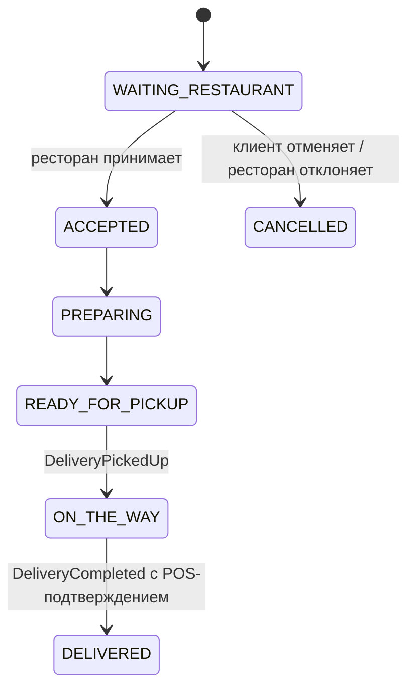
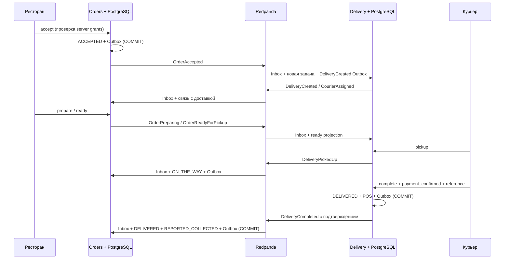

# ADR 0003: ресторанное исполнение, доставка и POS при получении

> Процесс исполнения и отмены уточнён в [ADR 0004](0004-fulfillment-saga.md):
> теперь есть persisted Saga, команды и обязательное назначение до приготовления.

Статус: принято. Дата: 2026-10-17. Уточняет ADR 0001 и ADR 0002.

## Решение и границы

В MVP нет онлайн-оплаты. Клиент оплачивает заказ через физический POS-терминал
курьера при получении. Payment Service, банковские API, authorization/capture,
refund и платёжные Saga не создаются. GPS, поиск курьера, маршруты и сверка с
банком также вне этапа.

Orders владеет заказом, его снимком цен, ресторанными переходами и состоянием
оплаты. Restaurant Management размещён в Orders: принятие и изменение заказа
должны проверять один aggregate в одной транзакции. Catalog продолжает владеть
меню; копия цен заказа остаётся неизменной.

Delivery — самостоятельный Go-модуль с domain/application/adapters/bootstrap,
собственной БД `delivery`, login role `delivery_service`, миграциями и бинарниками
API, consumer и outbox. PostgreSQL instance в локальном Compose разделяется с
Catalog/Orders, но роли не имеют доступа к соседним БД. Отдельный физический
кластер для Delivery можно подключить изменением DATABASE_URL; общей SQL-транзакции
между сервисами нет.

## Два жизненных цикла и оплата

Delivery проходит `PENDING_ASSIGNMENT → ASSIGNED → PICKED_UP → DELIVERED`.
`CANCELLED` предусмотрен для отмены ещё не забранной задачи при событии отмены
заказа; отдельной ручной отмены доставки в текущем API нет. Заказ после принятия
рестораном пока не отменяется: это требует отдельного процесса разрешения
ситуации, а не молчаливого освобождения курьера после выдачи еды.

Оплата имеет свои состояния `UNPAID → REPORTED_COLLECTED`; способ всегда
`POS_ON_DELIVERY`. Еда может готовиться или ехать, пока клиент ещё не заплатил.
Объединение оплаты с доставкой сделало бы эти состояния невыразимыми.
`REPORTED_COLLECTED` означает заявление назначенного курьера, а не банковскую
верификацию, расчёт с эквайером или доказательство зачисления денег.

## POS-подтверждение

POST complete требует `payment_confirmed=true`. Суммы и валюты в теле нет:
Delivery берёт их из сохранённого `OrderAccepted`, который содержит доверенный
снимок итоговой суммы Orders. Любые дополнительные поля, включая `amount_minor`,
отклоняются. Опциональный POS reference ограничен 200 символами без NUL/CR/LF.
Назначенный курьер обязан находиться в состоянии PICKED_UP.

Одна SQL-транзакция блокирует доставку, проверяет домен, меняет её статус,
сохраняет единственную `pos_confirmations` и `DeliveryCompleted` в Outbox,
освобождает курьера. Deferred constraint triggers проверяют наличие и совпадение
подтверждения у DELIVERED при COMMIT. PK delivery_id и UNIQUE order_id не дают
создать вторую запись оплаты. Повтор с тем же курьером и reference возвращает
первое подтверждение без изменения версии/времени/Outbox. Изменённый reference —
409; другой курьер — 403. Пустой reference разрешён и также идемпотентен.

Сохраняются OrderID, DeliveryID, AmountMinor, Currency, PaymentMethod, POSReference,
ConfirmedBy, ConfirmedAt. Orders сохраняет копию подтверждения в order_deliveries.
Эти данные позволят позднее добавить сверку с POS-реестром; в MVP сверка не
выполняется и новый статус банковской оплаты не придумывается.

## Согласованность через Kafka

Используется существующая Redpanda: `orders.events.v1` и `delivery.events.v1`.
Ключ Kafka — ID соответствующего агрегата; consumer groups Notifications,
Delivery и Orders независимы. Order события получили новые типы без изменения
schema_version=1 и полей старых OrderCreated/OrderCancelled. `DeliveryCreated`
задаёт версию 1 нового агрегата; назначение, выдача и завершение увеличивают её.
Внутренняя проекция готовности из Order не увеличивает версию Delivery, так как
не публикует новый факт его жизненного цикла.

Каждый business write и Outbox атомарны внутри своей БД. Worker использует
существующий алгоритм lease/claim_token, SKIP LOCKED, backoff, DEAD/requeue и
упорядочение неопубликованных версий одного агрегата. Для независимой сборки
Delivery имеет локальную реализацию этого же алгоритма; сервисы не импортируют
internal друг друга. Публичные контракты вынесены в contracts, общие домены не
вводятся.

Inbox фиксирует event_id и (aggregate_id, version) с fingerprint известных полей;
дубли не повторяют бизнес-эффект, конфликт идентичности отклоняется. Последовательная
версия входного потока проверяется под row lock. Delivery допускает начальную
версию 2 для старого заказа, созданного до появления Outbox. Неизвестные,
конфликтующие или пропущенные версии не обходятся. Новые consumers останавливаются
без commit offset при ошибке, включая неизвестную схему: рестарт повторит запись.
Это сознательный fail-closed вариант для финансово значимого состояния; в отличие
от Notifications, автоматического карантина с продвижением offset у них нет.
Ошибочная запись блокирует свою partition до исправления причины. Retention
Kafka по умолчанию 7 дней: восстановление задержанных consumers нужно выполнять
до истечения retention либо через сохранённый Outbox и план replay. Бесконечная
доставка при произвольной потере Kafka-хранилища не обещается.

Offset подтверждается только после Inbox COMMIT; при сбое между COMMIT и ACK
повтор обработается идемпотентно. Ошибка offset commit прекращает чтение, поэтому
нельзя подтвердить более поздний offset поверх необработанного сообщения.
Compose перезапускает consumer, native-запуску нужен supervisor или ручной рестарт.
HTTP-ответ о завершении Delivery может предшествовать обновлению Orders: это
ожидаемая eventual consistency. Order меняет оплату и статус одной транзакцией
по одному событию; ожидания отдельного PaymentCollected нет.

## Конкурентность и доступ

Restaurant use cases проверяют user → restaurant grants, затем SQL выбирает
заказ именно этого ресторана с FOR UPDATE. Переходы выполняются доменными методами.
Incoming list использует keyset pagination и один SQL snapshot с order_items.

При назначении сначала блокируется доставка, затем курьер. Статус AVAILABLE
проверяется под блокировкой; курьер становится BUSY. Дополнительно partial UNIQUE
по courier_id для ASSIGNED/PICKED_UP исключает две несовместимые активные задачи.
Завершение или отмена освобождает курьера в той же транзакции. Блокировка доставки
сериализует pickup/complete и конкурирующее назначение; Inbox использует те же
строки при изменении проекции. Неизменяемые grants копируются конструкторами.

Настоящая authentication ещё не реализована. Только явный DEV_AUTH_ENABLED=true
в APP_ENV=development/test разрешает X-Dev-User-ID, X-Dev-Courier-ID и прежний
X-Dev-Customer-ID. Restaurant grants и dispatcher IDs задаются на сервере, а не
в запросе. APP_ENV=production с dev identity отклоняется при старте. При выключенном
dev auth бизнес-endpoints отвечают 401 до интеграции настоящего identity adapter.
Dev-заголовки допускают подмену личности и разрешены только в доверенном локальном
окружении; порты Compose публикуются на 127.0.0.1.

## Почему нельзя SQL из Delivery в Orders

Прямая запись обошла бы доменные переходы Orders, авторство его данных, Inbox,
версии агрегата и атомарный Outbox. Она потребовала бы межсервисных DB credentials,
связала схемы/релизы и не решила бы сбой между изменением двух независимых БД.
Delivery сообщает о собственном факте; Orders сам применяет его в своём домене.

## Миграция

Новые миграции Orders 000003 и Notifications 000002 применяются поверх старых,
уже применённые SQL-файлы не переписываются. PENDING_PAYMENT в orders становится
WAITING_RESTAURANT, payment поля получают POS_ON_DELIVERY/UNPAID. ID, items, суммы,
версии и timestamps сохраняются. Outbox bytes и idempotency response не меняются;
Restore читает старый State без payment fields/version и сохраняет исторический
PENDING_PAYMENT в ответе replay, хотя GET показывает актуальный статус.

Перед обновлением остановить старых writers/consumers, сделать backup, применить
миграции и запустить новые бинарники. Это согласованное обновление, не обещание
совместимости старого writer с новой схемой. Откат 000003 запрещён, если уже есть
новые бизнес-состояния, события или связи Delivery: данные не удаляются и не
маскируются под PENDING_PAYMENT. Для них нужен roll-forward или восстановление
согласованной резервной копии. Delivery down предназначен только для тестового
сброса/пустого окружения и удаляет его таблицы.
