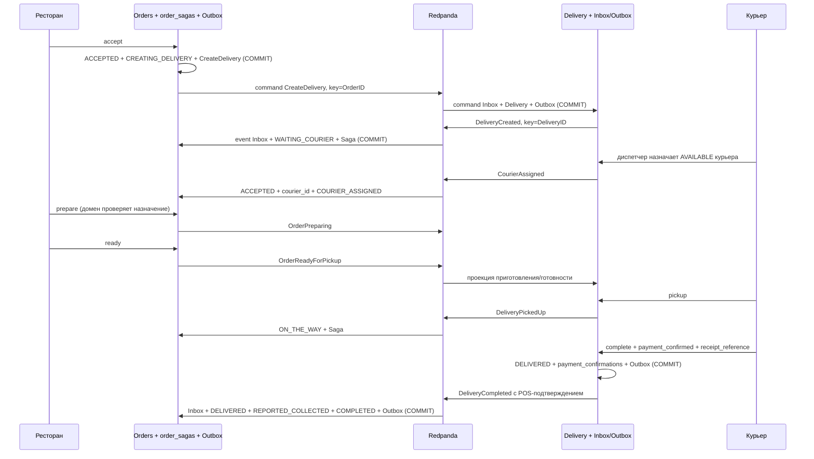
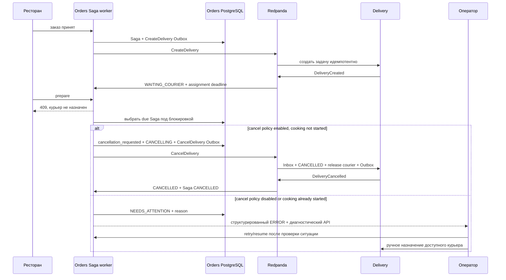

# ADR 0004: Order Fulfillment Saga в Orders

Статус: принято. Дата: 2026-10-18. Уточняет процесс из ADR 0003; модель POS остаётся прежней.

## Контекст и границы

Оплата только POS_ON_DELIVERY, UNPAID → REPORTED_COLLECTED. Это заявление курьера
об оплате на физическом терминале; банковского подтверждения, Payment Service,
authorization/capture/refund и банковской Saga нет. Денежный статус независим от
приготовления и доставки. Идентификатор подтверждения, receipt reference, сумма,
валюта, курьер и время сохраняются для будущей сверки; сама сверка не реализована.

Saga нужна и без онлайн-оплаты: принятие заказа, создание доставки, назначение,
приготовление и физическая выдача происходят в разных сервисах и в разное время.
Общей SQL-транзакции между ними нет. Timeout не доказывает, что удалённая операция
не выполнилась. Поэтому нужно хранить прогресс, безопасно повторять команды и
получать результаты компенсаций.

Оркестратор находится в Orders: этот bounded context владеет обещанием выполнить
заказ и политикой начала приготовления. Отдельный Saga-сервис добавил бы ещё
одного владельца бизнес-процесса. Temporal и универсальный workflow framework
для этого конкретного процесса не нужны.

State Machine проверяет допустимый локальный переход агрегата. Saga использует
такие переходы, но дополнительно координирует несколько агрегатов/БД через
сохраняемые команды, дедлайны и компенсации. Она не является Event Sourcing или
распределённым ACID rollback.

## Зависимости и состояние

Domain Orders содержит Order с закрытым состоянием и Saga с правилами переходов.
Application Fulfillment выполняет оркестрацию и возвращает конкретные эффекты:
событие заказа, команды и повтор уже сохранённой команды. PostgreSQL adapter
в одной транзакции блокирует Order, затем Saga, применяет use case и сохраняет
Order/Saga/Outbox. HTTP и Kafka consumers не устанавливают произвольные статусы.
Delivery Application обрабатывает CreateDelivery/CancelDelivery через доменные
методы; SQL adapter сохраняет результат с Inbox/Outbox.

Order: WAITING_RESTAURANT → ACCEPTED → WAITING_COURIER → ACCEPTED → PREPARING →
READY_FOR_PICKUP → ON_THE_WAY → DELIVERED. Первое ACCEPTED означает принятие
рестораном; после DeliveryCreated начинается WAITING_COURIER. Второе ACCEPTED
подтверждает назначение. Одного текста ACCEPTED недостаточно для приготовления:
домен требует положительный courier_id и отсутствие cancellation_requested,
application дополнительно проверяет Saga COURIER_ASSIGNED.

Состояния Saga: WAITING_RESTAURANT, CREATING_DELIVERY, WAITING_COURIER,
COURIER_ASSIGNED, PREPARING, READY_FOR_PICKUP, ON_THE_WAY, CANCELLING, COMPLETED,
CANCELLED, NEEDS_ATTENTION. В order_sagas сохраняются версия Saga, последняя
версия Delivery, связь с доставкой/курьером, correlation ID, текущая команда и
её sequence, attempts, deadline, next_attempt_at, reason, отдельная причина отмены cancel_reason и timestamps.

Delivery сохраняет PENDING_ASSIGNMENT/ASSIGNED/PICKED_UP/DELIVERED/CANCELLED.
Курьер имеет OFFLINE/AVAILABLE/BUSY и created_at/updated_at. Отказ до pickup
освобождает курьера и возвращает Delivery в PENDING_ASSIGNMENT. Готовность еды
при этом не теряется. После приготовления Order остаётся PREPARING/READY_FOR_PICKUP,
даже если courier_id сброшен: физически приготовленную еду нельзя «разготовить».

## Успешный сценарий

Имя DeliveryPickedUp сохранено из v1 вместо переименования исторического события
в CourierPickedUp. Новые типы CourierReleased, DeliveryCancellationRejected и
DeliveryStateReported добавлены совместимо. Последний позволяет получить
актуальный снимок существующей доставки при восстановлении/миграции без
прямого доступа к её БД.

## Курьер не назначен

Автоматического подбора нет: worker никогда не выбирает курьера. «Повторить поиск»
в MVP означает разрешить ещё один интервал ожидания и выполнить ручное назначение.
При новом CourierAssigned Saga может продолжиться после ожидания/эскалации.

## Retry, timeout и ручное разрешение

Отдельный Orders cmd/saga выбирает due записи через FOR UPDATE OF orders SKIP LOCKED.
Все операции берут блокировки в порядке Order → Saga. Несколько workers могут
работать одновременно. Состояние расписания хранится в PostgreSQL, поэтому
перезапуск не сбрасывает deadline или attempts.

Повтор CreateDelivery/CancelDelivery использует прежние MessageID, sequence и
Outbox body. Повторно активируется опубликованная/DEAD запись; активный lease не
перехватывается. Задержка — capped exponential backoff с equal jitter, тот же
проверенный механизм, что у Outbox. Транспортные retries Outbox и бизнес-ожидание
ответа Saga независимы. По исчерпании attempts/deadline сохраняется NEEDS_ATTENTION
с причиной; заказ не исчезает и не объявляется автоматически выполненным.

По умолчанию SAGA_CANCEL_BEFORE_PREPARING=false: timeout назначения требует
оператора. При true, если приготовление ещё не началось, Saga отправляет
CancelDelivery. Приготовление, готовность, дорога и ожидание курьера после
приготовления имеют progress/assignment deadlines с эскалацией вместо отмены.

GET Saga показывает состояние/причину/deadline/attempts. POST retry разрешён
только для NEEDS_ATTENTION и авторизованного управляющего ресторана (в локальном
dev/test он выполняет роль оператора). Retry повторяет незавершённую команду
или возвращает допустимую фазу ожидания. Для восстановления связи новый запрос
CreateDelivery получает новый sequence/ID, а прежняя заблокированная команда
также возвращается в публикацию. На существующей Delivery он выдаёт StateReported,
не вторую доставку. Повтор снимка с тем же назначением не создаёт ещё один
OrderCourierAssigned. Retry не может поставить DELIVERED или подтвердить оплату.

## Компенсация — бизнес-операция

Отказ до принятия отменяет Order локально; Delivery для него не создаётся. Отказ
после принятия или отмена клиентом до приготовления выставляют
cancellation_requested и отправляют CancelDelivery. HTTP возвращает текущую
репрезентацию с флагом, конечный CANCELLED появляется по ответу Delivery.
Приготовление во время CANCELLING запрещено. Даже если CreateDelivery ещё не
доставлена, CancelDelivery остаётся сохранённой командой; более ранняя DEAD-команда
возвращается к публикации, чтобы не заблокировать компенсацию.

Delivery идемпотентно отменяет pending/assigned задачу и освобождает курьера.
Запись delivery_requests с cancelled=true не позволяет запоздалому CreateDelivery
восстановить отменённое задание. Если Cancel пришла раньше Create, появляется одна
уже отменённая задача с последовательностью Created/Cancelled в той же транзакции;
поздний Create не создаёт новую активную работу.

После приготовления или pickup CancelDelivery возвращает
DeliveryCancellationRejected и не меняет физическое состояние. Orders сохраняет
NEEDS_ATTENTION. При pickup одновременно с отменой фиксируется исключение
picked_up_during_cancellation. Оператор проверяет реальность ситуации и делает
resume; допустимое подтверждение фактической доставки всё равно требует POS от
назначенного курьера. Фактическое завершение может завершить Saga из исключения.
Ни готовую еду, ни доставленный заказ SQL-компенсацией не отменяют.

## Контракты, порядок и идемпотентность

orders.events.v1 содержит факты Orders, delivery.events.v1 — факты Delivery,
delivery.commands.v1 — направленные команды. MessageID/EventID, CorrelationID,
AggregateID, AggregateVersion, SchemaVersion, OccurredAt обязательны; ответы на
команды также имеют CausationID. Для команд AggregateID — OrderID и версия —
монотонный command sequence Saga; для событий Delivery — DeliveryID и его версия.

В Orders Outbox добавлен stream. Уникальность и порядок проверяются по
(stream, aggregate_id, aggregate_version), поэтому версии команд не конфликтуют
с версиями Order и команды не попадают в Notifications. Producer маршрутизирует
два потока на настроенные topics. Новая инфраструктура брокеров не добавляется.

Delivery command Inbox хранит fingerprint по MessageID и (OrderID, command version).
Повтор той же команды не изменяет Delivery и может перепубликовать сохранённый
ответ с прежним EventID. Иной payload с той же идентичностью — конфликт.
delivery_requests блокируется на время команды; меньшие версии не применяются.
Это отличается от строгой последовательности событий: Cancel не обязан ждать
несуществующий Create, но после него Create не должен воскресить задачу.

Событийные Inbox продолжают дедупликацию по EventID и версии. Orders требует
следующую версию Delivery; разрыв не продвигает offset и диагностируется. Уже
увиденные старые события пропускаются; неизвестная устаревшая версия не меняет
новое состояние, а конфликт известной идентичности отклоняется. Поздний
DeliveryCreated не отменяет уже запрошенную компенсацию даже после NEEDS_ATTENTION;
её бизнес-причина хранится отдельно от причины timeout. Order projection в
Delivery сохраняет готовность/приготовление независимо от порядка чтения двух
topics, но версии внутри orders.events.v1 проверяются последовательно.

Offset подтверждается после DB COMMIT. Сбой после COMMIT до ACK повторит запись
без повторного эффекта. Ошибка SQL/контракта/commit прекращает consumer без ACK;
Compose перезапускает его. Ошибка offset commit также останавливает чтение, чтобы
не подтвердить более позднюю запись поверх сбоя. При брокерном отказе восстановление
group может ждать Kafka session/rebalance timeout. Глобального exactly-once нет.

Карантин Notifications остаётся прежним. Для финансово значимых consumers ошибка
блокирует partition до исправления; их лог содержит coordinates и безопасные
идентификаторы. Kafka retention и Outbox retention по умолчанию 7 дней, DEAD
требует диагностики/requeue. Нельзя гарантировать восстановление после удаления
всех копий истории или согласованности при ручном сбросе offsets в обход Inbox.

## POS и конкурентность

Delivery row lock сериализует assign/decline/pickup/complete/command. Назначение
блокирует AVAILABLE курьера и делает его BUSY; partial UNIQUE не допускает двух
активных доставок одного курьера. OFFLINE/BUSY назначить нельзя. Сам курьер может
переключать только AVAILABLE/OFFLINE, пока не BUSY.

Complete требует payment_confirmed=true. Сумма и валюта берутся из сохранённой
стоимости заказа, методы/ConfirmedBy/timestamp/ID контролируются сервером.
Delivery, единственная payment_confirmations и DeliveryCompleted коммитятся
атомарно. PK delivery_id/UNIQUE order_id защищают от второй оплаты. Повтор с тем
же receipt возвращает прежнюю запись; другой receipt — 409, чужой курьер — 403.
Deferred DB constraints проверяют соответствие оплаты доставке. Дополнительные
StateReported могут обновить updated_at доставки, но не ConfirmedAt оплаты.

Сервисы никогда не меняют SQL-таблицы друг друга: это обошло бы инварианты,
локальные транзакции, Inbox/Outbox и владение данными, связало бы схемы/релизы и
потребовало бы чужих credentials. Каждая логическая БД имеет собственную роль;
нет межсервисных FK.

## Обновление существующих данных

Применяются только новые миграции Orders 000004, Delivery 000002, Notifications
000003. Применённые SQL-файлы не переписываются. PENDING_PAYMENT уже обрабатывает
Orders 000003: строки становятся WAITING_RESTAURANT без удаления заказов; старые
Outbox и immutable creation responses сохраняются и читаются старым v1 контрактом.

000004 создаёт Saga для каждого существующего Order. Терминальные заказы остаются
терминальными; активные переходят в фазу reconciliation без изменения статуса,
суммы, версии или timestamps самого заказа. Worker запрашивает состояние через
CreateDelivery. Существующая Delivery не дублируется. Сохранённая локальная версия
Order/Delivery учитывается; отдельный доменный путь связывает курьера из доверенного
pickup старого заказа, где до Saga courier_id не сохранялся. Признак legacy
reconciliation сохраняется отдельно от диагностической причины и переживает
timeout/эскалацию до получения доверенного назначения или pickup.

pos_confirmations переименовывается в payment_confirmations, reference сохраняется,
добавляется identity ID; courier updated_at заполняется прежним created_at. Старые
подтверждения и receipt не удаляются. В публичных событиях старое имя pos_reference
сохранено; HTTP принимает новое receipt_reference и прежний alias. Новые поля v1
optional/omitempty, поэтому fingerprints исторических событий остаются совместимыми.

Обновление согласованное: backup, остановка старых writers/consumers, миграции и
новые процессы. Старый writer не должен работать параллельно с новой политикой.
Откат с новой историей команд/назначений/состояний блокируется; безопасное действие —
roll-forward или восстановление согласованного backup, а не удаление заказов.
