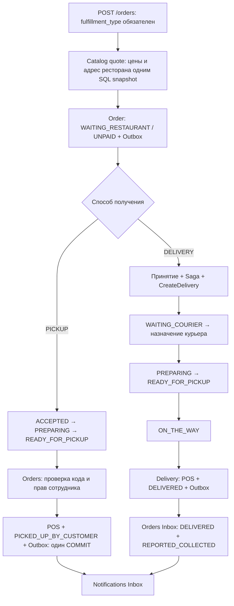

# ADR 0005: DELIVERY и PICKUP в одном Order

Статус: принято. Расширяет этап 8 и ADR 0003/0004.

## Решение и границы

Способ получения — типизированный `domain.FulfillmentType` одного Order aggregate.
Общие позиции, цены, сумма, клиент, ресторан, идемпотентность и переходы ресторана
имеют одни инварианты и одного владельца — Orders. Две модели заказа дублировали бы
эти правила. Pickup Service не нужен: выдача не содержит удалённого участника,
который владел бы самостоятельной частью бизнес-процесса.

Domain зависит только от стандартной библиотеки. Application Orders/Restaurants
определяет use cases и repository ports; PostgreSQL и HTTP реализуют их снаружи.
Fulfillment переиспользует Order. Для PICKUP он возвращает локальное изменение
без Saga и без команды. Для DELIVERY остаётся существующий persisted orchestrator
с deadline/retry/компенсацией и ручным восстановлением. Новой workflow-системы нет.



PICKUP никогда не создаёт `order_sagas`, `CreateDelivery` или `CancelDelivery`;
не ожидает CourierAssigned и не имеет courier deadlines. GET saga для PICKUP —
404, retry Saga — 409. Защита в домене и CHECK запрещает courier_id, ON_THE_WAY,
DELIVERED и cancellation_requested у PICKUP. Триггер запрещает Saga для PICKUP.

DELIVERY сохраняет существующий gate: готовка только после назначения курьера.
PICKUP может готовиться сразу после принятия. Самовывоз можно отменить локально
в WAITING_RESTAURANT или ACCEPTED; после начала готовки отмена запрещена.
Способ получения и снимки адресов неизменяемы с создания, что также исключает
смену способа после принятия. Отдельный endpoint изменения способа не вводится.

## Адреса, стоимость и создание

POST /orders требует fulfillment_type. Для DELIVERY обязателен delivery_address
(непустая строка до 500 символов); PICKUP отвергает адрес клиента. Адрес самовывоза
берётся из restaurant.address в Catalog и сохраняется снимком в Order. Внутренний
quote получает адрес и цены одним SQL-запросом; дополнительного сетевого вызова нет.
Ресторан без настроенного адреса не принимает PICKUP (409). Историческим ресторанам
адрес не придумывается: оператор заполняет его через существующий Catalog API.

PICKUP использует POS_AT_PICKUP, DELIVERY — POS_ON_DELIVERY. Оба начинают UNPAID.
Клиент не задаёт метод, статус оплаты, комиссию, сумму подтверждения или ConfirmedBy.
В существующем проекте расчёта доставки нет: delivery_fee_minor остаётся 0 для обоих
вариантов; никакой новой суммы не вводится. POS собирает subtotal_minor.

Новый delivery command v1 содержит optional fulfillment_type и delivery_address.
Новые заказы передают DELIVERY + адрес; Delivery сохраняет адрес в собственной БД
и показывает в авторизованном API задачи. Старые команды без полей по-прежнему
валидны, их canonical JSON/fingerprints сохраняются за счёт omitempty.

Хеш Idempotency-Key включает fulfillment_type и клиентский адрес DELIVERY.
Снимок адреса ресторана не входит в клиентский запрос: replay сохраняет прежний
адрес/цены и не вызывает Catalog. Перестановка позиций остаётся эквивалентной.
Новые заказы без fulfillment_type отклоняются. Исключение — точный replay
существующего исторического запроса без новых полей: исходный хеш проверяется
до Catalog, возвращается прежний результат, новый заказ так создать нельзя.
Сохранённые исторические результаты создания не переписываются.

## Безопасная выдача и POS

```mermaid
sequenceDiagram
    participant C as Клиент
    participant O as Orders
    participant DB as Orders PostgreSQL
    participant R as Сотрудник ресторана
    participant K as Redpanda / Notifications
    O->>K: OrderReadyForPickup, fulfillment_type=PICKUP
    C->>O: POST /orders/id/pickup-code, своя identity
    O->>DB: lock Order, READY_FOR_PICKUP; сохранить SHA-256 кода
    O-->>C: случайный код, expires_at, Cache-Control no-store
    C->>R: предъявить код (например QR)
    R->>O: verify-pickup(code), проверить до оплаты
    O->>DB: lock Order; проверить готовность, код, expiry и лимит
    O-->>R: READY_FOR_PICKUP / UNPAID, без события
    R->>R: получить оплату физическим POS
    R->>O: complete-pickup(code, payment_confirmed, receipt_reference)
    O->>O: проверить server-owned grants сотрудника
    O->>DB: lock Order → pickup_codes; проверить код/expiry/лимит
    O->>DB: confirmation + PICKED_UP_BY_CUSTOMER / REPORTED_COLLECTED + Outbox
    DB-->>O: COMMIT
    O-->>R: заказ завершён
    O->>K: OrderPickedUpByCustomer
```

Код — 16 криптографически случайных байт в 32 hex-символах (128 бит энтропии).
Это предъявляемый секрет, пригодный для QR, а не короткий числовой PIN.
Сервер возвращает его только авторизованному владельцу готового заказа; исходный
код не сохраняется. SHA-256 и constant-time comparison достаточны для равномерного
128-битного секрета: медленный password hash не нужен. Код нельзя восстановить;
повторный pickup-code выдаёт новый, инвалидируя прежний. Срок — 24 часа, после
истечения клиент может запросить новый, пока заказ готов и ещё не выдан.

Пять неправильных проверок блокируют выдачу на 15 минут. Счётчик и блокировка
хранятся в PostgreSQL, выдерживают рестарт и конкурентные запросы. Отрицательная
проверка коммитит только счётчик, затем возвращает 403; во время блокировки — 429.
Ротация владельцем сбрасывает счётчик. Сотрудник другого ресторана получает 403
до обращения к коду. Для правильного заказа чужого ресторана — 404 на уровне
scoped repository. Предварительный verify-pickup проверяет код до приёма POS и не меняет заказ.
Финальный complete-pickup повторяет проверку, исключая обход при ротации/истечении.
Готовность проверяется до выдачи, payment_confirmed обязателен.
Секрет передаётся в теле, исключён из URL, DTO заказов, событий и логов.

Order row lock сериализует выдачу, ротацию кода и остальные изменения. Уникальность
подтверждения по order_id не допускает двух оплат. Подтверждение, конечный статус
и OrderPickedUpByCustomer коммитятся одной транзакцией. Сбой SQL/Outbox/COMMIT
откатывает весь бизнес-эффект. Deferred constraint проверяет соответствие
подтверждения сумме, валюте, способу и конечному состоянию заказа.

Повтор complete-pickup с тем же кодом, сотрудником, payment_confirmed=true и
receipt_reference возвращает текущее завершённое состояние без новых записей,
включая повтор после рестарта и истечения срока кода. Проверка секрета сохраняется
и на replay. Другой сотрудник или чек — 409; оплата не перезаписывается.

REPORTED_COLLECTED означает заявление уполномоченного сотрудника ресторана либо
назначенного курьера. Банковского API, независимой проверки расчёта и сверки нет.
Audit хранит server-owned confirmed_by, amount_minor, currency, method, confirmed_at
и необязательный receipt_reference. Подтверждение ресторана принадлежит Orders;
подтверждение курьера — Delivery. Сервисы не пишут в чужие таблицы.

## События, совместимость и миграция

OrderReadyForPickup уже существовало: для обоих способов используется прежний
тип с optional payload.fulfillment_type. Добавлено OrderPickedUpByCustomer.
Notifications сохраняет тип получения вместе с PENDING intent, различая готовность
самовывоза и доставки. Как и до расширения, фактического SMS/email provider нет.
Delivery фиксирует Inbox/версию PICKUP, но не обновляет readiness/preparation
проекцию, не создаёт задач, POS или Outbox. Дедупликация и offset-after-COMMIT
остаются прежними. Orders отвергает Delivery facts для PICKUP.

Новые optional поля omitempty не меняют canonical bytes исторических событий.
Идентичности, версии агрегатов, старые Outbox тела и immutable creation responses
сохраняются. Старые consumers, не знающие нового типа, обновляются согласованно.

Новые миграции: Catalog 000003, Orders 000005, Delivery 000003, Notifications 000004.
Старые заказы были только доставкой: получают DELIVERY, прежние POS/status/version/
timestamps остаются без изменений. Неизвестный адрес обозначен
legacy_delivery_address=true и пустой строкой; новые заказы так создавать нельзя.
Исторические Saga и операционные POS-подтверждения сохраняются.
Новые коды и POS-подтверждения ресторана для старых заказов не генерируются.

Обновление: backup, остановка старых writers/consumers (включая Catalog), новые
миграции и согласованный запуск новых binaries. После появления новых данных
защита down запрещает потерю PICKUP-истории и настроенных адресов. Roll-forward
предпочтительнее отката; удаления volumes и обнуления состояний не требуется.
