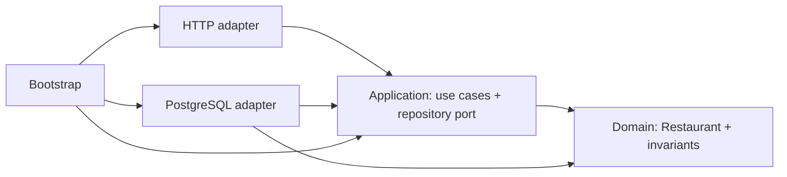
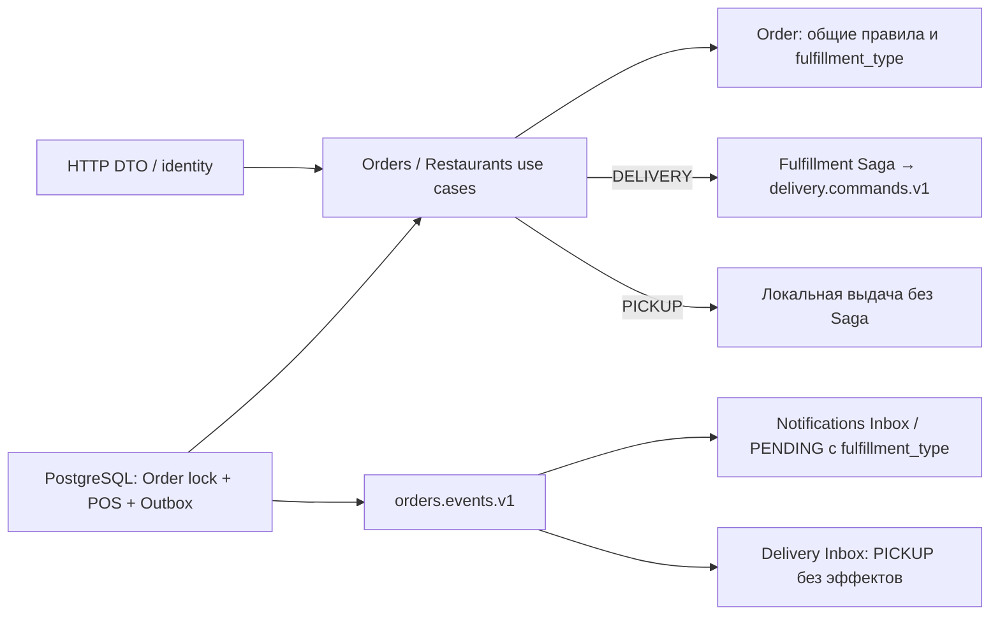

# Архитектура Catalog

## Направление зависимостей

Domain использует только стандартную библиотеку и не знает о JSON/SQL. Application
знает доменную модель и определяет порт persistence. PostgreSQL реализует этот
порт; HTTP вызывает use cases и преобразует доменные ошибки в HTTP-ответы.
Bootstrap — composition root: единственное место, которое знает все реализации.

## Поток запроса и бизнес-границы

HTTP handler -> application use case -> RestaurantRepository -> PostgreSQL.
Обратный путь: строка БД -> domain.Restaurant -> HTTP DTO -> JSON.

HTTP отвечает за метод, URL, JSON, Content-Type, ограничения тела и форматы ответа.
Домен отвечает за имя, положительный ID и допустимость частичного изменения.
Application применяет эти правила до persistence и ограничивает пагинацию.
Доменная сущность не содержит транспортных тегов. SQL-адаптер отвечает за хранение,
параметры запросов и преобразование pgx.ErrNoRows в domain.ErrNotFound. SQL CHECK
защищает базовые инварианты также при записи вне приложения.

Один Restaurants объединяет связанные use cases модуля. Отдельные классы для
каждого endpoint и универсальный CRUD repository не нужны. Application-интерфейсы RestaurantRepository и MenuRepository нужны для смены
адаптера и независимого тестирования use cases. Readiness получает функцию проверки БД,
поскольку это infrastructure-проверка, а не бизнес-use case.

## Конкурентность

pgxpool безопасен для параллельного использования. PostgreSQL выдаёт identity ID.
PATCH выполняет один UPDATE с COALESCE для отсутствующих полей и RETURNING для
ответа. PostgreSQL блокирует строку на время UPDATE. Это сохраняет изменения
разных полей при конкурентных PATCH; при изменении одного поля побеждает последний
UPDATE. Optimistic locking и версии сущностей пока не вводятся.

## Жизненный цикл

Конфигурация читается из env и проверяется до старта. Bootstrap настраивает pool,
проверяет соединение и наличие схемы, создаёт repository, use cases и handlers.
Миграции запускает отдельный Compose job, а не каждая реплика приложения.

HTTP deadlines передаются через context в pgx. Ограничения чтения/записи/idle
настроены отдельно. SIGINT/SIGTERM вызывают Shutdown с новым, не отменённым
контекстом. После завершения HTTP закрывается pool. При истечении shutdown timeout
сервер закрывает соединения принудительно.

## Monorepo

У каждого сервиса свой go.mod и internal; это препятствует случайному импорту
внутренних моделей соседнего сервиса. go.work нужен только для локальной разработки.
Docker собирает Catalog независимо от workspace. Общие deploy и docs находятся
на уровне репозитория; пустых сервисов и общих domain-пакетов нет.

## Модуль меню

MenuCategory принадлежит Restaurant и задаёт группировку/порядок. MenuItem —
отдельная сущность с ценой, валютой и доступностью. У категорий и блюд разные
жизненные циклы: блюдо можно изменять, перемещать и мягко удалять без изменения
категории. Отдельный aggregate root с универсальным CRUD не введён.

Application.Menu объединяет шесть use cases модуля и получает существующий
RestaurantRepository плюс один focused MenuRepository. Правила денег, имени,
описания и частичного изменения живут в domain; use cases проверяют наличие
ресторана и принадлежность категории. Domain не импортирует HTTP, pgx или SQL.

В БД составной внешний ключ `(restaurant_id, category_id)` ссылается на
`menu_categories(restaurant_id, id)`. Дополнительная UNIQUE-пара обеспечивает этот
FK; имена категорий и блюд не ограничены уникальностью. CHECK запрещают
неположительную цену, другую валюту, пустое имя и отрицательный порядок.
Цены — int64/BIGINT в минимальных единицах, без float и ошибок двоичной дроби.

HTTP использует отдельные DTO. PATCH читает optional поля через RawMessage и
указатели: отсутствие отличается от false, 0 и пустой строки, null запрещён.
Публичная проекция не выдаёт служебные timestamps и deleted_at. Административные
и публичные маршруты регистрируются отдельно. Каждая мутация проверяет OIDC
principal и серверный grant конкретного ресторана; создание ресторана требует admin.

GetRestaurantMenu использует один LEFT JOIN от restaurants через категории к
неудалённым блюдам. Это проверяет наличие ресторана, сохраняет пустые категории
и даёт согласованный снимок без N+1. В Go строки группируются в категории.
Порядок: категории `(sort_order, id)`, блюда `id`. Индексы соответствуют связям и
активному меню. Недоступность не равна удалению.

Изменение выполняется одним параметризованным UPDATE с RETURNING и блокировкой
строки PostgreSQL. Пропущенные поля сохраняются через COALESCE. Soft delete
обновляет deleted_at; все последующие PATCH/DELETE требуют `deleted_at IS NULL`.
Конкурентный PATCH не может воскресить удалённую строку. Идентичность блюда и
исторические данные остаются для будущих связей с заказами.

Каждая запись здесь — одна атомарная SQL-команда, чтение меню — одна команда с
одним MVCC snapshot. Поэтому дополнительные явные транзакции вокруг одиночных
команд не нужны. Проверки application не заменяют FK/CHECK: БД гарантирует
целостность и при изменении данных между проверкой и записью. Если появится
операция с несколькими связанными записями, ей понадобится явная транзакция.

## Order Service

Orders — отдельный bounded context и Go-модуль. Полное решение по Order aggregate,
внутреннему quote, подтверждению суммы, транзакциям, конкурентной идемпотентности,
идентификации и sequence diagram записано в
[ADR 0001](adr/0001-orders-catalog-integration.md). Направление вызова — Orders →
Catalog; каждый сервис использует только свою database и собственную login role.
Catalog теперь имеет два listener: публичный API и приватный batch quote.

## События заказов и Notifications

Orders сохраняет OrderCreated/OrderCancelled в outbox_events атомарно с заказом.
Отдельный worker claim-ит записи короткой SQL-командой с SKIP LOCKED/lease и публикует
в Redpanda после завершения транзакции. Проверка claim_token ограждает новое владение
от позднего обновления старым worker. Событие повторяемо, event_id неизменен.

Notifications — отдельный Go-модуль и PostgreSQL-процесс. Его domain владеет PENDING
intent; application определяет Inbox/MessageSource ports и consumer use case.
PostgreSQL adapter атомарно сохраняет processed_events + notification; Kafka adapter
подтверждает offset после COMMIT. Публичные DTO находятся в contracts/orders/v1;
импорта domain другого сервиса нет. Bootstrap управляет lifecycle и зависимостями.

Решение по версиям, reordering, retry, карантину, retention и всем ограничениям:
[ADR 0002](adr/0002-outbox-inbox.md). Синхронный quote Orders → Catalog сохранён.

## Restaurant Fulfillment и Delivery

Актуальные границы и гарантии — [ADR 0003](adr/0003-pos-fulfillment.md),
запуск и API — [fulfillment](fulfillment.md). Orders владеет ресторанным циклом
и состоянием оплаты; Delivery владеет доставкой и операционным POS-подтверждением.
Они обмениваются событиями через существующую Redpanda, без прямого SQL между БД.
Домены используют только стандартную библиотеку; HTTP DTO и публичные event DTO
находятся в адаптерах и contracts соответственно. Application определяет порты;
Bootstrap собирает pgx/Kafka/HTTP реализации через конструкторы.

## Persisted Fulfillment Saga (этап 8)

[ADR 0004](adr/0004-fulfillment-saga.md) заменяет событийную реакцию создания
Delivery на явную оркестрацию внутри Orders. Application Fulfillment принимает
решения; домен проверяет переходы; adapters коммитят Order + Saga + команды
Outbox атомарно. Delivery Application исполняет команды и доменные методы в
своей Inbox-транзакции. Никаких межсервисных SQL/FK нет.

Команды delivery.commands.v1 отделены от orders.events.v1/delivery.events.v1;
версии команды, заказа и доставки независимы. Таймеры Saga перезапускаются из
PostgreSQL, без Redis/Temporal. Для DELIVERY приготовление до CourierAssigned запрещено,
отмена после приготовления/выдачи требует исключения и операторского решения.

## PICKUP + DELIVERY

[ADR 0005](adr/0005-pickup-and-delivery.md) расширяет Order типом получения и
локальной выдачей. Domain владеет общей state machine и запретом выдачи неготового
или неоплаченного заказа. Application определяет клиентскую ротацию секрета,
проверку grants сотрудника и порты; PostgreSQL сериализует операции Order row lock
и атомарно сохраняет POS audit, конечное состояние и Outbox. Исходный код выдачи
не хранится, не логируется и не попадает в события. PICKUP не имеет Saga строки.

Catalog quote возвращает цены и адрес ресторана одним SQL snapshot. Orders
сохраняет место самовывоза, а адрес DELIVERY передаёт отдельной командой в Delivery.
Notifications сохраняет тип получения для готовности самовывоза; Delivery для
PICKUP сохраняет лишь Inbox/version fencing без бизнес-эффектов.

## Security & Reliability (этап 9)

[ADR 0006](adr/0006-security-and-consumer-quarantine.md) описывает серверные
issuer/subject bindings, роли и resource authorization. `platform/security`
используется только bootstrap/HTTP adapters, business layers не зависят от JWT.
Новый локальный persistence adapter каждого consumer сериализует process/park/replay,
повторяет временные ошибки и сохраняет poison/dependent messages в своей БД.
Service-wide fence охватывает разные partitions и commands/events Delivery.
Inbox/Outbox продолжают атомарно фиксировать бизнес-эффекты; публичные event JSON
и fingerprints совместимы. Operational replay проходит через прежние domain gates.
Настройка и восстановление — [runbook](security-reliability.md).

## Automatic Courier Dispatch

[ADR 0007](adr/0007-automatic-dispatch-and-redis-geo.md) добавляет Redis GEO только
как временный индекс кандидатов Delivery. Application определяет Locations и
DispatchRepository; Redis/PostgreSQL adapters реализуют эти порты, bootstrap
запускает worker внутри Delivery API. Общий чистый contracts/geo value object
не выполняет I/O. Domain.Assign и прежний transactional Outbox остаются основой
назначения; PostgreSQL владеет доступностью, lease, cooldown и конкурентными
инвариантами. Между claim и назначением Redis вызывается без SQL-транзакции.
Orders сохраняет Catalog snapshot и deadline, продолжая прежнюю fulfillment Saga.
[API, эксплуатация и ограничения](automatic-dispatch.md).
