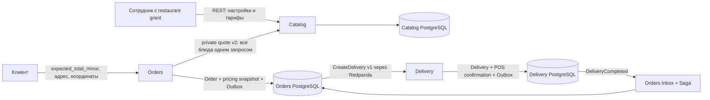

# Delivery Zones & Pricing — этап 13

Catalog владеет тарифами и настройками способов получения: они меняются вместе с
рестораном и меню. Отдельный Pricing Service добавил бы сетевой вызов и новую
границу согласованности без самостоятельной бизнес-ответственности. Orders
использует private batch quote, сверяет подтверждённую сумму и сохраняет договорённость.
Delivery получает готовую сумму для физического POS. Чужие БД сервисы не читают.



В каждом сервисе HTTP/persistence адаптеры зависят от application и domain;
application использует порты, domain не знает об HTTP и PostgreSQL. Bootstrap
соединяет зависимости конструкторами. Redis GEO, offers и tracking сохраняют
существующую ответственность и не участвуют в расчёте стоимости.

## Настройки и тарифы

`delivery_enabled`, `pickup_enabled`, `minimum_delivery_subtotal_minor` принадлежат
ресторану. Последнее поле — минимум стоимости **блюд**, применяется только к DELIVERY.
У мигрированных и новых ресторанов DELIVERY выключена, PICKUP включён; для PICKUP
по-прежнему нужен ресторанный адрес. DELIVERY дополнительно требует парные координаты
ресторана и хотя бы один тариф. Включённый флаг сам по себе не означает доступность.

DeliveryTariff содержит `id`, `restaurant_id`, `max_distance_meters`,
`delivery_fee_minor`, `created_at`, `updated_at`. Радиус положительный; fee неотрицательный,
включая бесплатную доставку. Уникальность `(restaurant_id,max_distance_meters)`
обеспечивает PostgreSQL. Ответы сортируются по радиусу. Деньги — `int64` в minor units:
100 дирамов = 1 сомони (TJS). 1000 minor units = 10 сомони.

Выбирается первый тариф с `distance_meters <= max_distance_meters`:
при границах 2000, 5000, 8000 диапазоны равны [0,2000], (2000,5000], (5000,8000].
За пределами 8000 доставка недоступна. Нижних границ в БД нет: удаление среднего
тарифа расширяет диапазон следующего. Произвольные пересечения и одинаковые границы
не возникают. Увеличение стоимости с расстоянием не обязательно: это настройка ресторана.

Haversine вычисляет центральный угол между двумя точками на сфере:
`h = sin²(Δlat/2) + cos(lat1)·cos(lat2)·sin²(Δlon/2)`,
`d = 2R·atan2(√h, √(1−h))`, где R = 6371008.8 метра. Широты/долготы переводятся
в радианы, h ограничивается [0,1] из-за погрешности float64. Результат один раз
округляется **вверх** до целого метра; этот же int64 возвращается в quote и выбирает
диапазон. Никакого epsilon, зависящего от запроса, нет. Совпадающие точки дают 0.
NaN, Inf, latitude вне [-90,90], longitude вне [-180,180] отклоняются.

Это приблизительное расстояние по прямой на сфере, не расстояние по дорогам и не ETA.
Реки, горы, мосты, односторонние дороги и административные границы не учитываются.
Координаты клиента — заявленная точка: числовая валидация не подтверждает её
соответствие текстовому адресу. Geocoding, карты и routing engines не подключены.
Полярные зоны можно тарифицировать; ограничение Redis GEO по широте всё ещё требует
ручного назначения курьера, как описано в automatic-dispatch.md.

## Admin REST API Catalog

Все маршруты ниже требуют существующей OIDC identity с `restaurant_staff` и grant
данного ресторана либо deployment-owned `admin`. Поля прав из тела не принимаются.
Dev-заголовки разрешены только при прежнем явном development/test opt-in.

| Метод и путь | Тело | Успех |
|---|---|---|
| GET /restaurants/{id}/delivery-settings | нет | 200: `{settings,tariffs}` |
| PUT /restaurants/{id}/delivery-settings | все три настройки | 200: `{settings,tariffs}` |
| POST /restaurants/{id}/delivery-tariffs | max_distance_meters, delivery_fee_minor | 201: тариф |
| PUT /restaurants/{id}/delivery-tariffs/{tariffId} | оба поля тарифа | 200: тариф |
| DELETE /restaurants/{id}/delivery-tariffs/{tariffId} | нет | 204 |

PUT заменяет настройки/значения тарифа полностью, а не обнуляет пропущенные поля.
ID и timestamps назначает сервер. Тариф другого ресторана не изменяется.
Ошибки: 400 — некорректные/пропущенные поля, отрицательная сумма, нулевой радиус;
401 — нет identity; 403 — нет grant; 404 — нет ресторана/его тарифа;
409 — одинаковый максимальный радиус; 405 — метод; 413/415 — тело/Content-Type;
500 — обезличенная внутренняя ошибка. JSON: `{"error":"message"}`.

Пример локального opt-in окружения:

```sh
curl -X PATCH localhost:8080/restaurants/1 \
  -H 'Content-Type: application/json' -H 'X-Dev-User-ID: 10' \
  -d '{"address":"Душанбе, ресторан","latitude":38.56,"longitude":68.77}'
curl -X PUT localhost:8080/restaurants/1/delivery-settings \
  -H 'Content-Type: application/json' -H 'X-Dev-User-ID: 10' \
  -d '{"delivery_enabled":true,"pickup_enabled":true,"minimum_delivery_subtotal_minor":13000}'
curl -X POST localhost:8080/restaurants/1/delivery-tariffs \
  -H 'Content-Type: application/json' -H 'X-Dev-User-ID: 10' \
  -d '{"max_distance_meters":2000,"delivery_fee_minor":1000}'
```

## Private quote v2

`POST /internal/v2/menu/quote` на закрытом listener Catalog:

```json
{"restaurant_id":1,"fulfillment_type":"DELIVERY","delivery_location":{"latitude":38.56,"longitude":68.77},"items":[{"menu_item_id":1,"quantity":2}]}
```

Ответ для блюда по 6500:

```json
{
  "restaurant_id":1,"currency":"TJS",
  "restaurant_location":{"latitude":38.56,"longitude":68.77},
  "items":[{"menu_item_id":1,"restaurant_id":1,"name":"Плов","quantity":2,"unit_price_minor":6500,"currency":"TJS"}],
  "items_subtotal_minor":13000,"delivery_fee_minor":1000,"total_minor":14000,
  "delivery_available":true,"distance_meters":0,
  "pricing_snapshot":{"settings_version":4,"minimum_delivery_subtotal_minor":13000,"tariff_id":1,"max_distance_meters":2000,"delivery_fee_minor":1000,"distance_meters":0}
}
```

`settings_version` — монотонная версия ресторана; изменения настроек, координат и
тарифов увеличивают её. Тарифы и версия изменяются в одной транзакции. Блюда,
координаты, флаги, минимум, версия и тарифы читаются одним SQL statement/MVCC snapshot.
Нет запроса на каждое блюдо. Изменения меню не обязаны увеличивать pricing_version:
все цены позиций включены непосредственно в quote и заказ.

Недоступный способ получения возвращает 200 с `delivery_available=false` и
`unavailable_reason`: `delivery_disabled`, `restaurant_coordinates_missing`,
`tariffs_missing`, `outside_delivery_zone`, `minimum_delivery_subtotal`,
`pickup_disabled`, `pickup_address_missing`. Поле availability относится к выбранному
способу получения. `distance_meters` отсутствует при PICKUP и при неизвестных координатах
ресторана. Стоимость недоступного quote нельзя использовать для создания заказа.
Для PICKUP `fulfillment_type=PICKUP`, поле `delivery_location` опускается,
`delivery_fee_minor=0`, `total_minor=items_subtotal_minor`, minimum доставки не применяется.

Существующие ошибки ресторана/блюд сохраняются (404/409), invalid_quote,
invalid_coordinates и amount_overflow возвращают 400 с `error`/`code`.
Все умножения quantity × price и сложения сумм проверяют границы int64.
V1 остаётся переходным batch API для прежних Orders; новые Orders используют только v2.
Оба маршрута отсутствуют на публичном listener; frontend обращается через доверенный backend.

## Создание и сохранение Order

```sh
curl -X POST localhost:8081/orders \
  -H 'Content-Type: application/json' -H 'X-Dev-Customer-ID: 7' \
  -H 'Idempotency-Key: pricing-demo-1' \
  -d '{"restaurant_id":1,"fulfillment_type":"DELIVERY","delivery_address":"Душанбе, клиент","delivery_latitude":38.56,"delivery_longitude":68.77,"expected_total_minor":14000,"items":[{"menu_item_id":1,"quantity":2}]}'
```

PICKUP передаёт restaurant_id, fulfillment_type, items, expected_total_minor; координаты
и адрес клиента не передаются. Currency можно опустить (TJS), другая валюта запрещена.
Новые запросы обязаны содержать положительный `expected_total_minor`.
`expected_subtotal_minor` сохранён только для чтения старых request fingerprints и
точных исторических повторов; новая заявка только с ним запрещена. При наличии обоих
подтверждённой суммой является expected_total_minor; остальные поля входят в fingerprint.

Ответ 201 содержит `subtotal_minor`, `delivery_fee_minor`, `total_minor`,
`pricing_snapshot`, для DELIVERY — `delivery_latitude`/`delivery_longitude`,
а также прежние поля заказа и снимки блюд. Клиентские цены, fee, total, payment facts,
customer IDs и тарифные снимки в теле не принимаются.

Если текущий quote отличается от expected_total_minor:

```json
{"error":"order total changed; obtain a current quote and confirm expected_total_minor","code":"price_changed","current_quote":{"items_subtotal_minor":13000,"delivery_fee_minor":2000,"total_minor":15000,"currency":"TJS"}}
```

Это 409, заказ и Idempotency response не записаны. Клиент подтверждает новую сумму
и повторяет оформление; при отсутствии успешного результата ключ можно использовать
повторно. Недоступный способ получения также даёт 409. Повтор уже успешного запроса
возвращается из Orders до обращения в Catalog; новый тариф не меняет этот ответ.
Порядок блюд нормализуется, координаты и expected total входят в fingerprint.

В Order неизменяемы финансовые суммы, валюта, тарифный снимок, оба снимка координат и
адреса. Защита есть в domain и триггерах PostgreSQL; переходы fulfillment обновляют
только бизнес-состояние. `total_minor` в PostgreSQL — stored generated сумма
`subtotal_minor + delivery_fee_minor`. Она не обращается к текущим тарифам.
Пересчёт исторического заказа изменил бы согласованную покупателем сумму и сумму POS,
поэтому его делать нельзя. Снимок нужен и после изменения/удаления тарифа.

### Граница согласованности

Catalog даёт согласованный quote на момент одного SQL statement. Затем Orders без
открытой SQL-транзакции Catalog проверяет ответ и сохраняет его в своей транзакции
с Saga, Idempotency response и OrderCreated Outbox. Между quote и commit ресторан
может изменить цены, координаты, тариф или отключить доставку. Уже полученный quote
остаётся допустимой ценой создаваемого заказа, если клиент подтвердил его total.
Это сознательная snapshot consistency, без распределённой транзакции, резервации цены,
TTL quote и обещания применить настройку, актуальную именно в момент commit Orders.
409 обнаруживает разницу с quote, но не блокирует последующее изменение Catalog.

## Delivery, POS и совместимость

CreateDelivery в `delivery.commands.v1` сохраняет существующее значение
`amount_to_collect_minor`, теперь равное **subtotal + fee**. Добавлено опциональное
`delivery_location` (omitempty). Адрес, координаты ресторана, customer_id и dispatch
window сохраняются. Новые суммы `total_minor` и `delivery_fee_minor` в
`orders.events.v1` тоже опциональны с omitempty; subtotal_minor всегда означает блюда.
Новые consumers сверяют сумму с total_minor, а при его отсутствии — с историческим
subtotal_minor. Идентификаторы, версии потоков, типы событий и исторические
канонические байты для Inbox fingerprint не меняются. Новый topic не требуется.

Delivery хранит полную сумму и точку назначения при создании. При complete курьер
подтверждает показанную сервером полную сумму, не выбирает amount/currency из тела.
Completion, confirmation на полную сумму, освобождение курьера и DeliveryCompleted
Outbox коммитятся вместе. Повтор не дублирует confirmation/event. Orders Inbox
проверяет полную сумму и вместе завершает Saga/DELIVERED/REPORTED_COLLECTED.
Это заявление о физическом POS, а не банковская верификация. PICKUP подтверждает
сумму блюд в прежней транзакции выдачи, без Delivery и Saga.

### Deployment и откат

1. Применить Catalog 000005, Orders 000008, Delivery 000008. Они не меняют JSON
   сохранённых idempotency responses, Inbox/Outbox и старые финансовые факты.
   Исторические fee=0, total=ранее согласованный subtotal, координаты остаются NULL.
   Stored generated колонка требует переписывания orders: на большой таблице нужен
   согласованный maintenance window; lock_timeout задаёт оператор миграции.
2. Обновить все readers/consumers (Delivery оба потока, Orders delivery consumer,
   Notifications и shared contracts), затем Catalog v2 и все Orders API/Saga/outbox
   producers. До включения новых producers все consumers обязаны понимать total.
   Смешанная работа старых consumers с новыми ненулевыми fee не поддерживается.
3. Обновить клиентский backend на v2 и expected_total_minor. Настроить координаты,
   тарифы и явно включить DELIVERY. Старые активные Saga продолжают работать с
   прежней суммой, адресами и NULL координатами. Для единого включения новых producers
   при постепенном deployment используйте остановку входа создания/accept заказов.
4. После появления новых тарифных снимков не откатывать Orders на старую схему:
   down 000008 отказывается удалять такие данные (включая бесплатный новый тариф).
   Нужен forward fix. До новых снимков down не меняет historical response JSON.
   Обратные миграции других сервисов также выполнять только с остановкой нового кода.

## Проверка

```sh
./scripts/check.sh
./scripts/test-integration.sh
python3 scripts/verify-pricing.py
python3 scripts/verify-offers.py
python3 scripts/verify-pickup.py
```

check включает gofmt, go vet, go test, go test -race, независимые GOWORK=off builds,
Compose config. integration поднимает выделенные PostgreSQL/Redis/Redpanda,
делает полный round trip миграций и запускает integration tests с race.
Новые тесты проверяют геометрию, диапазоны, переполнение, правила способов получения,
HTTP ACL/CRUD, согласованность версии/тарифа при параллельном редактировании,
неизменность заказа и повторов, полный POS и Saga. E2E запускает настоящие сервисы
и Kafka; offers отдельно проверяет прежнее автоматическое назначение/acceptance,
pricing — ручное назначение с ненулевой стоимостью доставки.
Pricing E2E также включён отдельным job в CI.
