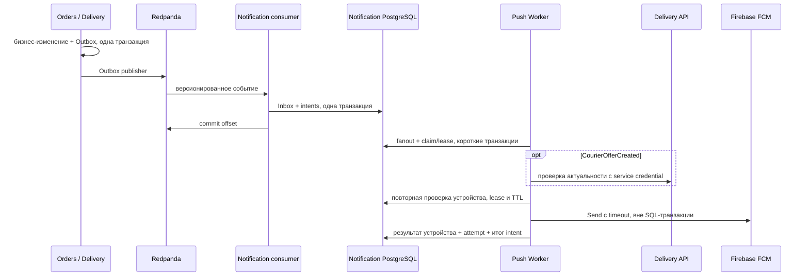

# Push Notifications — Stage 14

Notification Service владеет устройствами и отправкой. Firebase выбран как единый
официально поддерживаемый транспорт Android, iOS/APNs и Web Push; бизнес-сервисы
не получают Firebase credentials и не зависят от его доступности.



## Модель и гарантии

`notifications` — намерение уведомить конкретного получателя: тип CUSTOMER,
RESTAURANT или COURIER и серверный business ID, исходные event_id/event type,
correlation_id, русский title/body, безопасные data, ExpiresAt и состояние.
Один EventID может породить разные intents для клиента и ресторана. Уникальность
`(event_id,recipient_type,recipient_id)` предотвращает повторное создание intent.
Исторические столбцы и fingerprints Orders Inbox сохранены; старые намерения при
миграции получают CANCELLED и не превращаются в отложенную рассылку.
События без пользовательского шаблона сохраняются как CANCELLED для совместимости
с существующей историей. Они не создают доставок.

При первом fanout worker фиксирует набор активных регистраций. `push_deliveries`
хранит отдельное состояние доставки на каждое устройство, lease с UUID fencing,
число попыток и следующую дату. Новые регистрации не получают старую очередь.
`push_attempts` — журнал каждой начатой попытки с результатом provider; UNKNOWN
означает, что исход не записан, в том числе после падения процесса.
FCM-специфичные идентификаторы и безопасные коды находятся в persistence/provider,
а Domain не импортирует Firebase, HTTP или PostgreSQL.

Состояния: PENDING → PROCESSING → SENT / FAILED / CANCELLED. Повтор временной ошибки
возвращает delivery в PENDING; intent остаётся PROCESSING до завершения всех
доставок. Если хотя бы одна delivery завершилась FAILED, intent получает FAILED;
иначе хотя бы одна SENT даёт SENT, все отменённые — CANCELLED. Поэтому частичный
успех виден в истории устройств, даже если итог intent — FAILED.
SENT означает только принятие FCM. Это не подтверждение получения или прочтения.
Наличие push не заменяет API заказов/предложений, особенно для ресторана и курьера.

Kafka consumer не обращается к FCM: SQL Inbox и намерения коммитятся вместе;
Firebase не участвует в бизнес-транзакции, Kafka offset и Saga. Все входные топики
Notification Service используют прежний общий quarantine fence и audited replay.
Новые отправки при открытом карантине приостанавливаются; уже начатый внешний
запрос нельзя отозвать. Мониторить карантин нужно независимо от lag.

Доставка push **at least once с ограниченным retry budget**, а не exactly once.
Если FCM принял сообщение, а worker умер до записи результата, следующий процесс
после истечения lease может отправить его снова. История сохранит UNKNOWN и новую
попытку. Клиенту следует дедуплицировать `event_id` в рамках получателя; collapse
settings сокращают дубликаты ожидающих сообщений, но не дают гарантии.

## События и шаблоны

| Источник | Факт | Получатель |
|---|---|---|
| orders.events.v1 | OrderCreated | ресторан |
| orders.events.v1 | OrderAccepted, OrderRejected | клиент |
| orders.events.v1 | OrderReadyForPickup с fulfillment_type=PICKUP | клиент |
| orders.events.v1 | OrderOnTheWay (подтверждённый pickup курьером) | клиент |
| orders.events.v1 | OrderDelivered, OrderCancelled, OrderPickedUpByCustomer | клиент |
| orders.events.v1 | OrderCancelled | ресторан |
| delivery.events.v1 | CourierAssigned, DeliveryCancelled с известным CourierID | курьер |
| courier-offers.events.v1 | CourierOfferCreated | предложенный курьер |
| courier-offers.events.v1 | CourierOfferClosed со статусом CANCELLED | курьер |
| fulfillment.events.v1 | OrderNeedsAttention при переходе Saga в NEEDS_ATTENTION | ресторан |

Два новых v1-контракта находятся в `contracts/courieroffers/v1` и
`contracts/fulfillment/v1`. Их новые Outbox streams не меняют версии существующих
агрегатных событий и не поступают старым consumers Delivery/Orders. Версия stream
предложений: `offer_id * 2` для создания, `+1` для terminal-решения, ключ — DeliveryID.
Версия fulfillment stream — версия Saga, ключ — OrderID. Outbox сохраняется в той
же транзакции, что создание/закрытие предложения или переход Saga. Нет backfill
исторических назначений, предложений или проблем.

Для DECLINED/ACCEPTED не нужна отдельная push-квитанция решения самого курьера;
подтверждение назначения приходит через существующий CourierAssigned. EXPIRED
закрывает pending intent без нового запоздавшего push. Напоминания «скоро истечёт»
не добавлены: TTL предложения всего 30 секунд, ещё один push конкурировал бы с
первым и не подтверждал бы актуальную доступность.
Шаблоны отделены в application/templates.go, locale аргумент позволяет добавить
таджикский и английский. Адреса, GPS, POS-реквизиты и коды выдачи не включаются.

## Актуальность и retries

Обычные intents актуальны 24 часа от OccurredAt. Полученный terminal-факт Orders
(отмена, отказ, доставка или выдача клиенту) отменяет старые ещё не отправленные
OrderCreated/Accepted/Ready/OnTheWay; terminal version сохраняется, поэтому более
поздняя доставка старого события не возрождает его push. Event history сохраняется. CourierOfferCreated — до исходного
ExpiresAt предложения, максимум прежнего окна Saga. Terminal-факт в Inbox отмечает
предложение закрытым, даже если пришёл раньше создания, и отменяет ещё не отправленные
доставки. Состояние уже принятого FCM сообщения не переписывается как «отозвано».
Перед отправкой предложения worker дополнительно спрашивает
`GET /internal/push/offers/{id}?courier_id=...` у Delivery. Проверяются реальное
PENDING предложение, TTL, dispatch deadline, AVAILABLE курьер, delivery/preparation,
quarantine и отмена. Отказ/недоступность private API не разрешает отправку.
Это чтение API сервиса-владельца, без доступа к его БД из Notifications.

Проверка и FCM Send не атомарны с отменой/выходом: гонка после последней проверки
возможна. Принятое Firebase сообщение отозвать нельзя. Клиент всегда проверяет
предложение через API и игнорирует истёкшее, закрытое или принадлежащее другому
аккаунту событие. FCM TTL для Android, APNs и Web ограничен ExpiresAt; collapse ID
стабилен для повторов одного intent.

Workers используют PostgreSQL SKIP LOCKED и короткие транзакции, без сетевого I/O
под row locks. Lease восстанавливается после рестарта; UUID запрещает старому
worker фиксировать результат. Попытка резервируется до отправки: неоднозначный
исход расходует budget и сохраняет UNKNOWN. По умолчанию до 8 попыток, exponential
backoff с equal jitter, база 1 минута, максимум 1 час. Для актуального предложения
база ограничена 1 секундой, максимум — 5 секундами; Retry-After FCM имеет приоритет.
UNAVAILABLE/INTERNAL, quota, неизвестные транспортные ошибки и timeout повторяются.
FCM quota/unavailable получают минимум 1 минуту; поддерживаются Retry-After seconds
и HTTP date. SDK также может делать внутренние повторы внутри request timeout.
Неисправимый payload/auth/sender failure завершает delivery с безопасным кодом.

Общий PostgreSQL limiter ограничивает начало вызовов Send всеми репликами
(по умолчанию один за 100 мс). Это ограничение вызовов SDK; его внутренние HTTP
повторы могут добавить запросы. Firebase-квоты необходимо учитывать отдельно.
Просроченные intents, отозванные устройства и закрытые предложения не отправляются.
Нулевой fanout завершает intent CANCELLED/no_active_devices, не ждёт будущего login.

## API устройств и безопасность

Все три endpoint требуют OIDC Bearer с отдельной audience Notifications.
Используются тот же trusted HTTPS issuer/JWKS и deployment-owned identity registry,
RS256/ES256 и обязательный exp. Числовой ID не извлекается из subject или JWT ролей.

```http
POST /v1/devices
Authorization: Bearer <notifications-access-token>
Content-Type: application/json

{"owner_type":"CUSTOMER","platform":"ANDROID","installation_id":"<registered Firebase installation ID>"}
```

Для курьера: `owner_type=COURIER`, роль courier и CourierID из registry.
Для сотрудника: `owner_type=RESTAURANT`, `restaurant_id=1`, роль restaurant_staff
и разрешение на этот ресторан в registry. Поля `owner_id`, `registered_by`, `id`,
`is_active` клиент передавать не может. Другие неизвестные поля дают 400.
Platform: IOS, ANDROID, WEB. Создание и точный повтор возвращают 200 с метаданными,
без InstallationID. `GET /v1/devices` возвращает последние 200 регистраций текущего
UserID; `DELETE /v1/devices/{id}` идемпотентно деактивирует только свою запись и
возвращает 204, чужая/отсутствующая — 404.

Несколько устройств пользователя допустимы. Одна installation имеет ровно одну
активную привязку; повтор login того же пользователя/recipient обновляет LastSeenAt.
Смена пользователя или recipient под advisory lock деактивирует прежнюю запись и
создаёт новую с другим ID. Старый пользователь не может удалить новую регистрацию.
Непосредственно перед Send проверяются active и соответствие владельца intent;
registration ID никогда не переносится к другому пользователю. Logout должен вызвать
DELETE **до** потери access token. Клиенту следует удалить/сбросить installation при
смене аккаунта и не показывать сообщения прошлого аккаунта. FID необходимо считать
чувствительным идентификатором и передавать API только по HTTPS.

При отзыве устройства installation ID стирается из рабочей строки; остаются hash,
владелец, времена и история доставки. Не пишутся ни идентификаторы устройств, ни
raw Firebase errors, ни тела payload в логи/ответы API. Доступ к БД и резервным
копиям ограничивается ролью Notifications. Отзыв restaurant grants при изменении
registry требует также отзыва соответствующих активных устройств оператором —
registry не является отдельным динамическим User Service.

UNREGISTERED деактивирует только использованную регистрацию. INVALID_ARGUMENT
не деактивирует её: ошибка может относиться к payload. Периодическая bounded cleanup
деактивирует устаревшие регистрации (по умолчанию 30 дней без регистрации/refresh),
стирает адрес доставки и сохраняет audit. Клиент должен обновлять регистрацию при
старте/login и периодически, а также при изменении FID. Неактивные регистрации
не включаются в последующие fanout.

Dev/test требует APP_ENV=development/test и DEV_AUTH_ENABLED=true; production
запрещает dev identities. Для локальных примеров вместо Bearer: X-Dev-Customer-ID: 7,
X-Dev-Courier-ID: 1 либо X-Dev-User-ID: 10 с серверным DEV_RESTAURANT_GRANTS=10:1.
Смешивание этих заголовков не допускается. В production они отвергаются.

## Firebase и запуск

Закреплён официальный `firebase.google.com/go/v4 v4.22.0`. На проверенную дату его
`messaging.Message.Fid` поддерживается SDK, а документация Firebase рекомендует FID;
поле Token помечено deprecated. API принимает `installation_id`, а не registration
 token. Клиент должен зарегистрировать installation через совместимый клиентский
FCM SDK; произвольная локальная UUID или FID без регистрации FCM не заменяет её.
Источники: [отправка и FID](https://firebase.google.com/docs/cloud-messaging/send/admin-sdk),
[Go Message API](https://pkg.go.dev/firebase.google.com/go/v4@v4.22.0/messaging#Message),
[ошибки](https://firebase.google.com/docs/cloud-messaging/error-codes),
[управление регистрациями](https://firebase.google.com/docs/cloud-messaging/manage-tokens).

```bash
cp .env.example .env
# Локально PUSH_PROVIDER=fake, без Google credentials.
docker compose --env-file .env -f deploy/compose.yaml up --build -d
# Вне контейнера (DATABASE_URL должен указывать на notifications DB):
cd services/notifications
PUSH_PROVIDER=fake APP_ENV=development go run ./cmd/push-worker
```

Для реального FCM включите Cloud Messaging API в Firebase project, настройте APNs
и Web Push в Firebase, задайте PUSH_PROVIDER=fcm и FIREBASE_PROJECT_ID. Авторизация —
Google Application Default Credentials: предпочтительны workload identity/attached
service identity с разрешением cloudmessaging.messages.create в целевом проекте.
Для локального теста можно использовать ADC, доступные Google SDK. Credentials
не кладутся в checkout, образ или `.env` как JSON.

Пример отдельного Compose override **вне репозитория** для файлового ADC:

```yaml
services:
  notification-push-worker:
    environment:
      GOOGLE_APPLICATION_CREDENTIALS: /run/secrets/firebase_adc
    secrets: [firebase_adc]
secrets:
  firebase_adc:
    file: /absolute/path/outside/repository/adc.json
```

Запускайте с `-f deploy/compose.yaml -f /absolute/path/firebase.override.yaml`.
Production также требует OIDC config и отдельные audience каждого API, read-only
mount AUTH_IDENTITIES_FILE (как описано в security runbook), случайный общий
PUSH_RELEVANCE_KEY длиной минимум 32 байта для Delivery и Push Worker. Значение
`local-only-...` worker в production отвергает. DELIVERY_INTERNAL_URL доступен только
через доверенную сеть; не публикуйте `/internal/push/` через внешний ingress/proxy.
Внешняя сеть worker нужна для HTTPS Google API; DB остаётся внутренней.

## Rollout, наблюдаемость и тесты

Порядок: остановить старые push workers (до этапа их нет), применить новые миграции
Notifications 000006, Orders/Delivery 000009; обновить Notification consumer для новых
топиков; остановить все старые Orders/Delivery Outbox publishers и запустить их
новые версии с маршрутизацией streams; только затем обновить Orders/Delivery API
и Saga producers; наконец включить worker и регистрацию устройств. Старый формат вставки notifications
поддерживается trigger во время обновления, но не создаёт содержательного push.
Новые streams нельзя публиковать старым publishers. Не переписываются historical
Inbox hashes, immutable creation JSON, POS-факты или события GPS. Downgrade с новой
историей отказывается удалять audit; восстановление делается совместимым кодом.

`GET /metrics` доступен аутентифицированному admin: notifications_created_total,
push_accepted_total, push_errors_total, push_retries_total, notifications_pending,
notification_oldest_wait_seconds, devices_inactive. Метрики вычисляются по durable
SQL-истории и не сбрасываются при рестарте процесса. Мониторить возраст очереди,
FAILED, UNKNOWN, provider_auth/platform_auth/sender_mismatch и открытый карантин.
История: JOIN notifications → push_deliveries → push_attempts; payload и FID в
операционные выгрузки не включать. Slog содержит event_id/correlation_id, intent,
delivery, номер попытки и безопасный код результата.

Автоматические тесты используют fake PushProvider и HTTP transport официального
SDK; настоящие credentials и FCM не нужны. PostgreSQL tests проверяют транзакции,
уникальность, transfer, lease recovery, несколько workers и отмену.

```bash
./scripts/check.sh                  # test, race, vet, independent builds, Compose
./scripts/test-integration.sh       # PostgreSQL / Kafka / Redis, migration round trips
python3 scripts/verify-push.py      # весь поток HTTP → Outbox → Kafka → fake FCM
python3 scripts/verify-pricing.py
python3 scripts/verify-offers.py
python3 scripts/verify-pickup.py
# Только вручную на выделенном тестовом устройстве, с ADC:
cd services/notifications
TEST_REAL_FCM=true FIREBASE_PROJECT_ID=... TEST_FCM_INSTALLATION_ID=... \
  go test -run '^TestRealFCMOptIn$' ./internal/adapters/fcm
```

Реальный FCM smoke не входит в CI и действительно отправляет сообщение. Нет email,
SMS, маркетинга, frontend, Firebase в Domain, новых сервисов или онлайн-оплаты.
